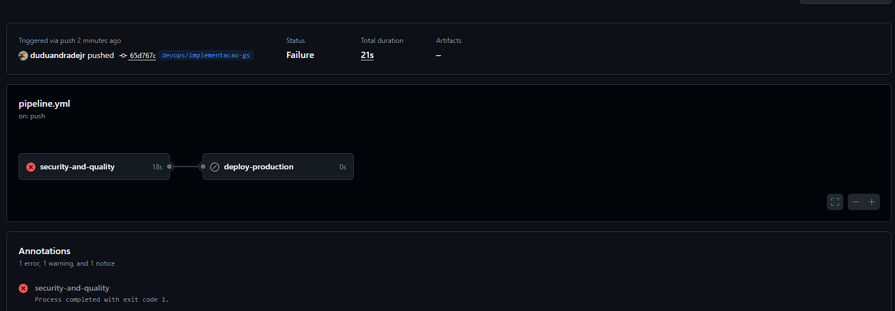
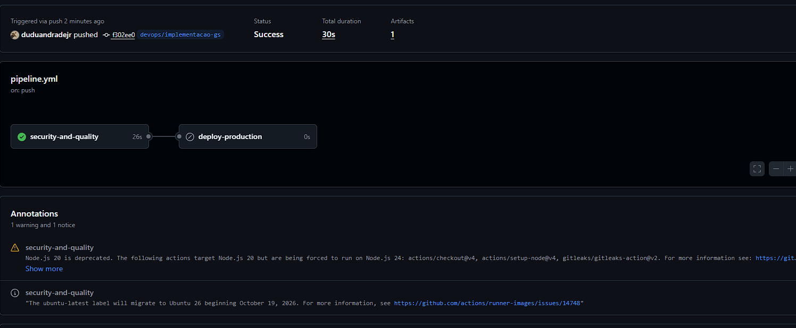

# FogoCerto · Secure DevOps Tools & Cloud Computing

Dockerfile, Terraform, pipeline GitHub Actions (build, Gitleaks, Semgrep, Trivy, deploy) e observabilidade.

> Terraform: `state` e `.tfvars` nunca entram no repositório (já bloqueados no `.gitignore`).

# Ficha Técnica - DevOps FogoCerto

## 1. Arquitetura e Deploy
- **Diagrama:** Github Actions ➔ Docker (Non-root) ➔ CloudFront ➔ PWA.
- **Responsabilidade:** A nuvem (AWS/Azure) cuida da infraestrutura física e CDN. A nossa equipe cuida da aplicação, da segurança (Gitleaks, Semgrep, Trivy) e do pipeline de deploy.
- **LGPD:** Nenhuma coleta de dados pessoais sensíveis; apenas o município escolhido fica salvo no `localStorage`.
- **Custo:** R$ 0,00 (Free Tier de armazenamento estático).
- **URL Pública:** [fogocerto.vercel.app]

## 2. Evidências do Pipeline (CI/CD)
Conforme exigido, o pipeline barra a execução caso encontre erros críticos no projeto. 

**Execução Barrada (Pipeline quebrou ao encontrar problema real):**

**Execução Corrigida (Problema resolvido, pipeline aprovado):**

