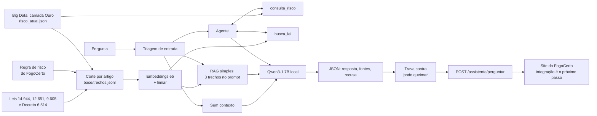

# FogoCerto · Generative AI for Engineering

[](https://colab.research.google.com/github/BrenoDevSilva/FogoCerto/blob/main/genai/genai/notebooks/fogocerto_genai.ipynb)

Assistente que responde dúvidas sobre **uso do fogo no meio rural** e sobre o **risco de fogo do dia no município**, em JSON, citando a fonte e recusando o que a base não cobre. Roda com uma LLM local (Qwen3-1.7B), sem API externa.

**Resultado principal** (94 perguntas de teste): sem contexto, o modelo acerta **30%** e alucina em **36%** das respostas (16% contando só as alucinações de conteúdo, [5.2](#52-placar-das-três-configurações)). Com a base de leis e os dados do Big Data (RAG), acerta **80%** e alucina em **3%**. As duas diferenças passam no teste estatístico.

## Mapa da avaliação

| Critério | Onde está |
|---|---|
| 1. Tarefa da IA e casos de teste com gabarito, incluindo "não consta" | [Ficha técnica](#2-ficha-técnica) · [Casos de teste](#casos-de-teste) · [`avaliacao/casos_teste.jsonl`](avaliacao/casos_teste.jsonl) · notebook, Etapa 2 |
| 2. Base de conhecimento em trechos com fonte | [Base](#4-base-de-conhecimento) · [`base/`](base/) · Etapa 3 |
| 3. Busca com recall@1 e recall@3 e limiar justificado | [Busca e limiar](#51-busca-e-limiar) · Etapas 4 a 6 |
| 4. Geração fundamentada: JSON válido, citação da fonte e recusa | [Placar](#52-placar-das-três-configurações) · Etapas 8 e 9 |
| 5. Especialização (agente) comparada ao RAG simples | [Interpretação](#53-interpretação) · Etapas 8 e 9 |
| 6. Placar das três configurações, com resultados interpretados | [Placar e margem de erro](#52-placar-das-três-configurações) · [Interpretação](#53-interpretação) · [Experimentos](#54-experimentos-uma-variável-por-vez) · [Limites](#55-limites-da-avaliação) · Etapas 9, 11 e 14 a 19 |
| 7. Cinco erros reais com proposta de correção | [Seção 6](#os-cinco-erros-a-causa-e-a-correção) · [`avaliacao/erros.md`](avaliacao/erros.md) (dois deles corrigidos e medidos de novo, mais três achados da conferência final) · Etapa 12 |
| 8. README e reprodutibilidade | este README · [Como reproduzir](#como-reproduzir) |
| Demonstração de alucinações | [Seção 6](#demonstração-de-alucinações) · [`avaliacao/alucinacoes.md`](avaliacao/alucinacoes.md) · Etapa 10 |

## O que mudamos depois do checkpoint

| Comentário do professor no checkpoint | O que fizemos aqui |
|---|---|
| Cada treino extra mudava dois parâmetros ao mesmo tempo | As três configurações mudam **uma coisa por vez** (só o contexto que o modelo recebe), e cada experimento muda um único item. Entre a rodada 1 e a 2 mudaram duas coisas (prompt do agente e triagem), e separamos o efeito de cada uma ([5.3](#53-interpretação), item 6) |
| Incluir mais informações nos dados de treino e teste | **138 casos com gabarito** (o checkpoint tinha 30 no teste manual): 44 no conjunto de ajuste e 94 no de teste, em 4 grupos de pergunta. **42 casos novos** foram escritos depois da primeira rodada; os 29 que caíram no teste são medidos à parte (os outros 13 ficaram no ajuste). Com 94 casos de teste, as diferenças principais passam no teste estatístico ([margem de erro](#margem-de-erro)). A base também cresceu: três leis, o decreto de multas, a regra de risco e o risco do dia |
| Testar mais configurações com mais dados e ver se melhora | Seis experimentos, um item por vez. Mais dados na base melhorou o resultado: de 66% (uma lei) para 80% de acerto (base completa) |

## 1. Integrantes

| Nome completo | RM |
|---|---|
| Breno Silva | RM99275 |
| Eduardo Araujo | RM99758 |
| Gabriela Trevisan | RM99500 |
| Gustavo Akio Alves Goto | RM550241 |
| Rafael Franck | RM550875 |

## 2. Ficha técnica

| Item | Descrição |
|---|---|
| Produto | FogoCerto: aviso diário de risco de fogo por município, com assistente que explica a lei. Repositório do produto: [BrenoDevSilva/FogoCerto](https://github.com/BrenoDevSilva/FogoCerto). |
| Cidadão e território | Pequeno produtor rural e defesa civil de 15 municípios do Pará. |
| Proposta de valor | Em uma pergunta, o produtor sabe o risco de fogo de hoje no município e o que a lei exige, com a fonte citada, sem que a IA autorize a queima. |
| Problema | O produtor e a defesa civil não têm um lugar simples para saber o que a lei permite sobre queima e qual é o risco de fogo do dia no município. Uma LLM sozinha inventa regras sobre o tema, o que pode levar alguém a queimar de forma ilegal ou perigosa. |
| Tema do enunciado | Segurança (prevenção de incêndios no meio rural). |
| Onde ver funcionando | Não há URL pública da API nesta entrega. A IA aparece funcionando no vídeo (seção 7) e na tela de demonstração do notebook (Gradio, link temporário gerado ao rodar). A API está pronta em `api/` e a ligação com o site é o próximo passo. |
| Tarefa da IA | Receber uma pergunta e devolver `{"resposta", "fontes", "recusa"}`. A API acrescenta a `confianca`, calculada pela evidência. |
| Modelo | `Qwen/Qwen3-1.7B`, local, sem API externa. |
| Busca | `intfloat/multilingual-e5-small`, com limiar de recusa escolhido no conjunto de ajuste. |
| Especialização | Agente com duas ferramentas: `busca_lei` (base de leis) e `consulta_risco` (camada Ouro do Big Data). Não houve ajuste fino dos pesos: o critério 5 aceita LoRA ou agente, e a escolha está justificada abaixo. Configuração recomendada pelo placar: RAG nas perguntas de lei e agente no risco do dia; a API atual usa só o agente, de forma provisória. |
| O que a IA não faz | Não autoriza queima, não dá parecer jurídico e não responde fora da base. Sempre encaminha ao órgão ambiental competente. |
| Explicabilidade | Toda resposta traz as fontes que o modelo recebeu de fato; as respostas sobre risco trazem os fatores do cálculo e a data do dado; a confiança vem da evidência, não do modelo. |
| Segurança | Recusa em quatro camadas: triagem de entrada por padrões de texto (pedido de autorização, de parecer, de burlar a fiscalização, tentativa de mudar as regras e município fora da cobertura), limiar da busca, o próprio modelo e uma trava que troca a resposta quando ela traz frases que liberam a queima ("pode queimar", "está liberada"). A triagem e a trava pegam as formas mais comuns, não todas as paráfrases ([limites](#55-limites-da-avaliação)). |
| LGPD | A IA não pede dado pessoal e a API não grava as perguntas. Se a pessoa escrever um relato pessoal ("fui multado..."), ele é usado só para responder e é recusado pela triagem quando pede parecer. Os dados de risco são agregados por município. |
| Por que agente e não ajuste fino (LoRA) | O critério aceita os dois. O risco muda todo dia e a lei precisa ser citada artigo por artigo: um ajuste fino gravaria o dado de um dia nos pesos e não daria a fonte. O agente consulta o dado do dia e a lei na hora da pergunta, e um modelo de 1,7B ajustado com poucas centenas de exemplos tende a decorar frases em vez de seguir a base. |
| ODS | **13** (meta 13.1, resiliência a riscos climáticos): aviso do risco do dia antes da queima. **2** (meta 2.4, produção agrícola sustentável): manejo do fogo dentro da lei. **3** (meta 3.9, menos doenças por poluição do ar): menos queimadas em dias de risco alto, menos fumaça. Como na proposta do FogoCerto. |
| Indicadores | Da IA, medidos aqui: acerto, alucinação, recusa correta e fonte citada. De impacto, para o produto: consultas ao assistente por município; proporção de focos de calor em dias de risco alto (backtest do Big Data); municípios cobertos e alertas enviados. |

## 3. Pipeline



## 4. Base de conhecimento

Gerada na Etapa 3 do notebook em [`base/trechos.jsonl`](base/trechos.jsonl). Tabela completa em [`base/fontes.csv`](base/fontes.csv); o HTML oficial de cada norma fica em [`base/originais/`](base/originais/).

| Fonte | Formato | Licença | Trechos |
|---|---|---|---|
| Lei 14.944/2024 (Política Nacional de Manejo Integrado do Fogo), inteira | HTML oficial (Câmara dos Deputados) | Texto oficial de norma federal (sem direito autoral, Lei 9.610, art. 8º) | 71 |
| Lei 12.651/2012 (Código Florestal), arts. 38 a 40 | HTML oficial | Texto oficial de norma federal | 4 |
| Lei 9.605/1998 (Crimes Ambientais), 14 artigos ligados a fogo | HTML oficial | Texto oficial de norma federal | 16 |
| Decreto 6.514/2008 (infrações e multas), arts. 3, 58, 58-A, 58-B e 60 | HTML oficial | Texto oficial de norma federal | 5 |
| Regra de risco do FogoCerto | Texto do grupo | Autoria do grupo | 4 |
| Risco de fogo por município (dados de 03/11/2026) | JSON da camada Ouro, convertido em texto | Derivado de dados abertos do INPE (Programa Queimadas, uso livre com citação da fonte) e do Open-Meteo (CC BY 4.0) | 16 |
| **Total** | | | **116** |

Os artigos são a unidade do corte porque é assim que a lei é citada. Artigos longos são divididos entre incisos e parágrafos, com o caput repetido em cada parte. O risco do dia entra na base para o RAG simples receber a mesma informação que o agente consulta pela ferramenta.

## 5. Performance

### 5.1 Busca e limiar

| Grupo | n | recall@1 | recall@3 | recall@5 |
|---|---|---|---|---|
| Todos (lei + F05) | 52 | 59,6% | 78,8% | 84,6% |
| Lei, pergunta direta | 30 | 70,0% | 86,7% | 90,0% |
| Lei, linguagem do produtor | 21 | 42,9% | 66,7% | 76,2% |

A linha "Todos" soma as 51 perguntas de lei e o F05 (valor da multa), que é do grupo 4 mas tem resposta no Decreto 6.514.

**Limiar: 0,860** ([`avaliacao/limiar.json`](avaliacao/limiar.json), gráfico em [`avaliacao/limiar.png`](avaliacao/limiar.png)). Regra: o maior limiar que ainda deixa passar pelo menos 95% das perguntas que a base responde, medido no conjunto de ajuste. Justificativa: uma pergunta barrada pela busca vira recusa certa, mesmo quando a base sabe a resposta; por isso a busca, que é só a primeira camada de recusa, não pode barrar o que a base responde. A escolha usou só as 25 perguntas de lei do conjunto de ajuste, então o valor exato é sensível a poucos casos. No conjunto de teste, que não participou da escolha, o limiar deixou passar 92,3% das perguntas da base, um pouco abaixo da meta de 95% (barrou L29, P10, P19 e P23), e barrou 82% das de fora. O experimento do limiar mostra os dois lados: sem limiar, o RAG acerta 1 pergunta a mais, mas recusa pior fora da base e alucina mais; com um limiar 0,03 mais rígido, o acerto cai de 80% para 60%.

**Risco do dia:** o recall acima mede só as perguntas de lei. Nas 20 perguntas de risco, o trecho do município veio entre os 3 recebidos pelo RAG em 19 (a exceção é R28, Castanhal), conferido nos contextos salvos em `respostas_rag.json`.

**Buscador:** com as palavras da lei, contagem de palavras (TF-IDF) e vetores de significado (e5) empatam (recall@3 de 86,7%). Na linguagem do produtor, o e5 vai de 38% para 67% de recall@3 ([`avaliacao/exp_buscador.csv`](avaliacao/exp_buscador.csv)).

### 5.2 Placar das três configurações

Conjunto de teste, 94 perguntas ([`avaliacao/placar.csv`](avaliacao/placar.csv), [`avaliacao/placar.png`](avaliacao/placar.png)):

| Configuração | Acertos | Acerto | Alucinação | Erro sem recusar | JSON válido | Fonte correta | Recusa correta | Tempo por pergunta |
|---|---|---|---|---|---|---|---|---|
| Sem contexto | 28/94 | 29,8% | 36,2% | 43,1% | 94,7% | 0,0% | 67,0% | 1,0 s |
| RAG simples | 75/94 | **79,8%** | 3,2% | **9,7%** | **100%** | **70,8%** | **87,2%** | 1,4 s |
| Agente | 62/94 | 66,0% | **2,1%** | 16,7% | 98,9% | 51,4% | 79,8% | 8,8 s |

Tempo: o sem contexto e o RAG foram medidos em lotes de 8 perguntas (o tempo do lote dividido por 8); o agente responde uma pergunta por vez e chama o modelo até 5 vezes. Numa medida pergunta a pergunta (Etapa 8, uma pergunta só), o RAG levou 10,0 s e o agente 9,0 s.

Acerto por grupo de pergunta:

| Grupo | n | Sem contexto | RAG | Agente |
|---|---|---|---|---|
| 1. Lei, pergunta direta | 30 | 23,3% | **83,3%** | 50,0% |
| 2. Lei, linguagem do produtor | 21 | 14,3% | **57,1%** | 33,3% |
| 3. Risco do dia (Big Data) | 20 | 15,0% | 80,0% | **90,0%** |
| 4. Fora da base ou parecer | 23 | 65,2% | **95,7%** | **95,7%** |

Casos originais × casos novos (escritos depois das correções, [`avaliacao/placar_por_lote.csv`](avaliacao/placar_por_lote.csv)):

| Configuração | Originais (65) | Novos (29) |
|---|---|---|
| Sem contexto | 16/65 (24,6%) | 12/29 (41,4%) |
| RAG | 48/65 (73,8%) | 27/29 (93,1%) |
| Agente | 45/65 (69,2%) | 17/29 (58,6%) |

**Como as métricas são medidas:** acerto = a resposta traz as informações do gabarito (palavras-chave), ou recusa quando devia; alucinação = respondeu o que devia recusar, citou fonte que não recebeu ou afirmou um nível de risco diferente do dado; erro sem recusar = tinha resposta, o modelo respondeu com segurança e errou; fonte correta = entre as 72 perguntas que tinham resposta, citou o artigo do gabarito (nas perguntas "posso queimar hoje?", o risco **e** a lei); recusa correta = o campo `recusa` bate com o gabarito. Com 94 casos, cada pergunta vale cerca de 1 ponto percentual.

**Quanto confiar na métrica** ([`avaliacao/auditoria_metrica.md`](avaliacao/auditoria_metrica.md)):
- Uma auditoria manual de 20 respostas sorteadas (código em [`avaliacao/amostra_auditoria.py`](avaliacao/amostra_auditoria.py)) concordou com a métrica em 17 (85%). Nas outras 3, a métrica foi generosa com respostas parciais, então os acertos reais com base são um pouco menores que os da tabela.
- Ela também foi generosa com o sem contexto: 3 dos 10 acertos dele nas perguntas de lei estão errados. Em 12 dos 72 casos com resposta, a palavra-chave do gabarito já aparece na própria pergunta. Sem esses 12 casos, o acerto fica em 26% (sem contexto), 78% (RAG) e 70% (agente), e as conclusões não mudam.
- Das 34 alucinações do sem contexto, 19 são só marcadores do formato no campo de fontes ("CONTEXTO", "fonte_id_1", "1", "FogoCerto"). Contando só as alucinações de conteúdo, o sem contexto fica em 16% (15/94), contra 3,2% do RAG e 2,1% do agente. A queda continua significativa (McNemar, p = 0,002).

#### Margem de erro

Com 94 perguntas, cada configuração tem uma margem de cerca de ±9 pontos (intervalo de confiança de 95%): sem contexto 22% a 40%, RAG 71% a 87% e agente 56% a 75%. Como as três responderam as mesmas perguntas, a comparação usa o teste de McNemar (exato, binomial), que olha só as perguntas em que uma acertou e a outra errou. Todos os números desta seção e da auditoria saem de `python avaliacao/estatisticas.py`, que lê só as respostas salvas:

| Comparação | Só a 1ª acertou | Só a 2ª acertou | p | Conclusão |
|---|---|---|---|---|
| RAG × sem contexto (todas) | 49 | 2 | < 0,001 | o RAG é melhor |
| RAG × agente (todas) | 23 | 10 | 0,035 | o RAG é melhor |
| RAG × agente (lei, 51 perguntas) | 20 | 5 | 0,004 | o RAG é melhor |
| Agente × RAG (risco do dia, 20 perguntas) | 4 | 2 | 0,69 | empate: 20 perguntas não bastam para separar os dois |

A alucinação também cai de forma significativa do sem contexto para o RAG (32 perguntas em que só o sem contexto alucinou, contra 1; p < 0,001). Nos recortes pequenos (5 perguntas "posso queimar hoje?", 20 de risco, 29 do lote novo), as diferenças são indicativas, não conclusivas.

### 5.3 Interpretação

1. **A base faz a IA acertar mais e alucinar menos.** Do modelo sem contexto para o RAG, o acerto sobe de 30% para 80% e a alucinação cai de 36% para 3% (de 16% para 3% contando só as alucinações de conteúdo). O ganho aparece em todos os grupos: 23% → 83% na lei com pergunta direta, 14% → 57% na linguagem do produtor, 15% → 80% no risco do dia. Sem contexto, o modelo não só erra: em 43% das perguntas que tinham resposta, ele erra com segurança, sem avisar que não sabe. Exemplos: um telefone inventado para o órgão ambiental, o "desmatamento controlado" como uso permitido do fogo, quando a lei proíbe, e "soltar balão não é crime" ([`avaliacao/alucinacoes.md`](avaliacao/alucinacoes.md)).
2. **O agente empata no risco do dia e na alucinação e perde na lei.** RAG e agente têm a mesma informação; muda só o jeito de obter o contexto. No **risco do dia**, o agente acerta 18 de 20 e o RAG 16 de 20, mas com 20 perguntas a diferença fica dentro da margem (p = 0,69). Os 2 erros do agente nesse grupo são do mesmo tipo: ele escreveu o nome do município errado na ferramenta ("Sourde" e "Sour", em vez de Soure) e respondeu que Soure não é coberto. Os 4 erros do RAG são perguntas "posso queimar hoje?" (item 7). Na alucinação, também há empate: 2 respostas do agente contra 3 do RAG, diferença de uma pergunta; e 3 respostas erradas do agente (F13, F17 e L22) escaparam dessa contagem por terem sido marcadas como recusa (seção 5.5). Nas perguntas de lei, perde para o RAG de forma significativa (22/51 contra 37/51, p = 0,004). Lendo as respostas, a causa principal é uma só: em 16 das 51 perguntas de lei, o agente **recusou sem consultar nenhuma ferramenta**, e o RAG acertou 12 dessas 16. Isso explica 12 das 15 perguntas de diferença (`erros.md`, erro 3). No placar, o agente leva 8,8 s por pergunta contra 1,4 s do RAG, mas o RAG foi medido em lotes de 8; pergunta a pergunta, os dois levaram de 9 a 10 s na Etapa 8.
3. **O sistema recusa quando deve.** No grupo de fora da base e de pedidos de parecer, RAG e agente recusam corretamente em 95,7% dos casos, contra 65,2% do modelo sem contexto. Essa recusa é do sistema em camadas, não só do modelo: a triagem de entrada recusou 11 pedidos antes do modelo (5 municípios fora da cobertura, 4 pedidos de parecer jurídico, 1 pedido de autorização e 1 tentativa de mudar as regras do assistente) e não barrou nenhuma pergunta que devia ser respondida; no RAG, o limiar recusou outras 9 e o modelo decidiu as 2 restantes.
4. **O formato se mantém, a citação ainda falha.** O JSON sai válido em 100% (RAG) e 98,9% (agente) das respostas. A fonte correta aparece em 71% das perguntas com resposta no RAG; o ponto fraco é o modelo às vezes escrever a fonte "de cabeça" (`erros.md`, erro 5). Em 8 respostas do RAG, o modelo também escreveu o valor da recusa dentro do texto da resposta (5 vezes "Recusa: true" e 3 vezes "Recusa: false").
5. **O lote novo confirma a vantagem do RAG, com ressalva.** Nas 29 perguntas escritas depois da rodada 1, que não foram usadas para corrigir o sistema, o RAG acertou 93%. O lote novo parece mais fácil (até o sem contexto sobe de 25% para 41%), então ele não prova sozinho que as correções generalizam. O agente cai no lote novo (59%) pelo motivo do item 2: nas 16 perguntas de lei desse lote, acertou 5 e recusou sem consultar a ferramenta em 8 (no lote original, acertou 17 de 35).
6. **Duas rodadas, com a mesma régua.** Na rodada 1, o agente respondia de memória (usou ferramenta em 15 de 64 perguntas; a comparação usa as 64 perguntas de teste que existiam nas duas rodadas, sem o F05, cujo gabarito mudou quando o decreto entrou na base). Depois das correções, usou em 41 de 64; os acertos subiram de 27 para 45 e a alucinação caiu de 66% para 3% ([`avaliacao/comparacao_rodadas.csv`](avaliacao/comparacao_rodadas.csv)). Entre as rodadas mudaram duas coisas, o prompt do agente e a triagem, então separamos os efeitos: nos 57 casos comuns que não passaram pela triagem, o agente foi de 24 para 38 acertos e de 36 para 2 alucinações; o ganho do RAG (+3) veio todo da triagem.
7. **A pergunta central, "posso queimar hoje em X?", ainda é o ponto fraco.** São só 5 casos no teste. O RAG acerta 1: em 3 deles, ele dá o risco e a lei, mas marca `recusa: true`, porque a regra 4 do prompt manda recusar pedidos de autorização e a regra 6 manda responder o "posso queimar?". O agente acerta 4, mas uma das respostas contadas como acerto está errada e é perigosa: no R28, ele diz que o art. 39 dispensa a autorização até 10 ha, quando esse artigo vale só para capacitação em manejo integrado do fogo. A métrica não pegou porque confere palavras-chave e fonte, não se a regra foi aplicada ao caso certo (`erros.md`, achados 6 a 8).

**Recomendação para o produto:** antes de abrir o assistente para produtores, resolver o conflito das regras 4 e 6, conferir o nome do município na ferramenta e ampliar os casos "posso queimar hoje?" (achados 6 a 8). Até lá, o caminho mais seguro é o RAG nas perguntas de lei e o agente no risco do dia, sempre com a trava e o aviso de que o FogoCerto não autoriza queima. Hoje a API usa o agente em todas as perguntas; separar os dois caminhos é um dos próximos passos.

### 5.4 Experimentos, uma variável por vez

Todos partem da configuração principal (RAG, k=3, limiar 0,860, temperatura 0, base completa, trechos de até 1.200 caracteres, Qwen3-1.7B) e mudam um único item. Arquivos `avaliacao/exp_*.csv`.

| Experimento | Variações (acerto) | Conclusão |
|---|---|---|
| Tamanho da base | só a Lei 14.944: 66,0% · 3 leis: 71,3% · + regra de risco: 75,5% · + Decreto 6.514: **79,8%** | O acerto subiu a cada degrau, mas cada degrau sozinho (4 a 5 perguntas) fica dentro da margem; o ganho total, de 62 para 75 acertos, é o resultado robusto. O recall@3 subiu de 56% para 79%. Parte do ganho vem de perguntas que só a nova fonte responde (as de multa só têm resposta com o Decreto 6.514) |
| Trechos entregues (k) | k=1: 68,1% · **k=3: 79,8%** · k=5: 79,8% | k=5 melhora um pouco a fonte correta (75% contra 71%), mas não o acerto, alucina um pouco mais (4,3% contra 3,2%) e deixa a resposta 24% mais lenta |
| Tamanho do trecho | 600 caracteres: 79,8% · **1.200: 79,8%** · artigo inteiro: 78,7% | Quase sem efeito; o artigo inteiro piora a fonte correta (64% contra 71%) |
| Limiar | sem limiar: 80,9% · **0,860: 79,8%** · 0,890: 59,6% | Sem limiar acerta 1 pergunta a mais, mas recusa pior no grupo 4 (91,3% contra 95,7%) e alucina mais |
| Temperatura | **0: 79,8%** · 0,7: 78,7% | Pouca diferença; 0 é reprodutível |
| Tamanho do modelo | Qwen3-0.6B: 43,6% · **Qwen3-1.7B: 79,8%** | O modelo do checkpoint não segue bem as regras do JSON e da citação |

Diferenças de até 1 pergunta (k=3 × k=5, tamanho do trecho, temperatura, sem limiar) ficam dentro da margem de erro e não são conclusivas. As diferenças grandes, de 10 pontos ou mais, são o tamanho da base, k=1, o limiar mais rígido e o modelo menor.

### 5.5 Limites da avaliação

- **Gabarito por palavras-chave.** A métrica não confere se a resposta diz sim ou não, nem se a regra foi aplicada ao caso certo. Exemplos que ela contou como acerto: "soltar balão não é crime" (L17, sem contexto) e "o art. 39 dispensa a autorização até 10 ha" (R28, agente). O efeito no placar foi medido na auditoria e não muda as conclusões.
- **Recusa medida pelo campo `recusa`.** O agente respondeu sobre ração de gado (F13) e deu uma receita (F17) marcando `recusa: true`, e ganhou "recusa correta". No L22, marcou recusa numa afirmação falsa sobre brigadistas, que por isso não entrou como alucinação.
- **Triagem e trava por padrões de texto.** Elas pegam as formas comuns, mas testamos frases que passam: município em minúsculas ("belem"), município logo no começo da frase ("Em Belém tem risco de fogo hoje?"), o formato que a própria API monta ("(município: Belém)"), "Pode me dar autorização pra queimar amanhã?", "pode tacar fogo" e "é possível queimar". A trava é aplicada na API e na tela de demonstração, não no placar; a coluna "autorizou queima" usa o mesmo detector e pode estar subestimada.
- **Uso do lote original.** As respostas da rodada 1 no lote original orientaram as correções e o ajuste de 4 gabaritos (L05, L18, P05 e P10). Por isso os casos novos (29 no teste) são medidos à parte.
- **Recortes pequenos.** "Posso queimar hoje?" tem 5 casos no teste, o risco do dia 20 e o lote novo 29: conclusões nesses recortes são indicativas.
- **Escopo da base.** O risco é o retrato de 03/11/2026, tratado como "hoje" na avaliação. No produto, a API lê o arquivo oficial do Big Data (`site/public/data/risco_atual.json`) com `FOGOCERTO_RISCO_PATH` (ver [Como reproduzir](#como-reproduzir)). Não há normas do Pará na base, então prazo, taxa e calendário de queima viram "não consta".

## 6. Alucinações e os cinco erros

### Demonstração de alucinações

O mesmo modelo, sem contexto, inventa em vez de dizer que não sabe; com a base, recusa ou responde com a fonte. Três dos seis casos de [`avaliacao/alucinacoes.md`](avaliacao/alucinacoes.md):

| Pergunta | Sem contexto | Com a base (RAG ou agente) |
|---|---|---|
| Qual o telefone do órgão ambiental de Santarém? (F08) | Inventa "(61) 3212-3212", um DDD de Brasília | Recusa: não consta na base |
| Qual o risco de fogo hoje em Oriximiná? (R01) | Diz "moderado" e cita uma fonte inexistente | Risco **alto**, 5 de 9 pontos, com os fatores e a data do dado |
| Soltar balão que pode provocar incêndio é crime? (L17) | "Não é crime", citando uma lei de resíduos sólidos | É crime: Lei 9.605, art. 42, detenção de 1 a 3 anos |

O arquivo traz também a contagem de cada tipo de alucinação por configuração e um caso que a métrica não pegou: o agente citou um artigo que existe, mas aplicado ao caso errado (R28).

### Os cinco erros, a causa e a correção

Detalhes, exemplos e tamanho de cada erro em [`avaliacao/erros.md`](avaliacao/erros.md).

| # | Erro | Causa | Correção | Situação |
|---|---|---|---|---|
| 1 | O agente respondia de memória e inventava fontes (rodada 1) | O modelo pequeno prefere responder a chamar ferramenta, e o exemplo do prompt virou "fonte padrão" | Tirar o exemplo do prompt e dar um lembrete quando ele responde sem consultar | **Aplicada e medida:** acertos de 27 para 45 em 64; alucinação de 66% para 3% |
| 2 | O RAG inventou o risco de Belém com os dados de Almeirim (rodada 1) | A busca sempre traz *algum* município, e o modelo trocou o nome | Triagem de entrada que recusa município fora da cobertura | **Aplicada e medida:** F01, F25 e F26 recusados nas três configurações |
| 3 | O agente recusa sem consultar as ferramentas | O lembrete só dispara quando ele responde de memória, não quando recusa | Disparar o lembrete também na recusa, ou chamar `busca_lei` no primeiro passo | Proposta: explica 12 das 15 perguntas de diferença para o RAG na lei |
| 4 | A consulta reescrita pelo agente perde a palavra-chave ("aceiro", P04) | A busca combinada fica com a maior nota, e a consulta genérica ocupa as vagas | Intercalar os resultados da pergunta original e da consulta | Proposta |
| 5 | Fonte inventada ou trocada com o conteúdo certo (L17, L07) | O modelo escreve a fonte "de cabeça" | Depois da geração, trocar fonte não recebida pelo trecho recebido mais parecido | Proposta (a API já descarta fontes não recebidas) |

Na conferência final, mais três achados, também com correção proposta: o RAG marca recusa no "posso queimar hoje?" porque duas regras do prompt se contradizem (erro 6); o agente escreve o nome do município errado na ferramenta (erro 7); e uma resposta perigosa foi contada como acerto (erro 8). A conferência da própria métrica está em [`avaliacao/auditoria_metrica.md`](avaliacao/auditoria_metrica.md).

## 7. Conclusão técnica e links

O objetivo da atividade foi atingido: com a base de leis e os dados do Big Data, a mesma LLM local acerta 2,7 vezes mais (de 30% para 80%) e alucina bem menos (de 36% para 3%, ou de 16% para 3% contando só as alucinações de conteúdo) que sem contexto, responde em JSON válido, cita a fonte e recusa o que não pode responder. O agente empata com o RAG no risco do dia e na alucinação, mas ainda perde para o RAG nas perguntas de lei porque às vezes recusa sem consultar as ferramentas; a correção está proposta. As diferenças principais foram confirmadas com teste estatístico nas 94 perguntas de teste. O ponto fraco que falta resolver é a pergunta central do produto, "posso queimar hoje?": o RAG tende a recusá-la e o agente acertou mais, mas com uma resposta perigosa que a métrica não pegou. Os experimentos mostram que a qualidade depende mais dos dados (a base completa vale 14 pontos de acerto sobre uma lei só) e do tamanho do modelo (o 1.7B vale 36 pontos sobre o 0.6B) do que dos parâmetros de geração.

Próximos passos: resolver o conflito das regras 4 e 6 do prompt, conferir o nome do município na `consulta_risco`, trocar a métrica por uma que confira sim/não e a regra aplicada, aplicar as correções dos erros 3 a 5, incluir normas estaduais do Pará sobre autorização de queima (com licença confirmada), ampliar a cobertura de municípios conforme o Big Data crescer, fazer a API escolher entre agente e RAG pelo tipo de pergunta e ligar o site do FogoCerto à API.

- Repositório: https://github.com/BrenoDevSilva/FogoCerto/tree/main/genai/genai
- Vídeo: https://youtu.be/qxFoTCS2zl0

## Estrutura

```
notebooks/     fogocerto_genai.ipynb (com as saídas salvas da rodada oficial)
base/          originais/ (HTML das normas) · trechos.jsonl · fontes.csv
avaliacao/     casos_teste.jsonl · recall.csv · limiar.json · placar.csv · placar_por_lote.csv · respostas_*.json
               alucinacoes.md · erros.md · auditoria_metrica.md (+ amostra_auditoria.py, estatisticas.py) · comparacao_rodadas.csv · exp_*.csv
               erros_todos.csv (todos os erros da rodada) · *_automatico.md (rascunhos gerados pelo notebook)
               ambiente.json (modelo, versões, GPU e parâmetros da rodada) · rodada1/ (primeira rodada)
dados/         risco_atual.json (cópia da camada Ouro usada na avaliação)
fogocerto_ia/  código usado pelo notebook e pela API
api/           POST /assistente/perguntar
```

## Como reproduzir

**No Google Colab (recomendado)**

1. Clique no botão **Open in Colab** no topo deste README e escolha **Ambiente de execução → Alterar o tipo → GPU T4**.
2. **Ambiente de execução → Executar tudo.** A Etapa 1 clona o repositório do FogoCerto, entra na pasta `genai/genai/` e instala as dependências. Além do placar, o "Executar tudo" roda os experimentos, baixa dois zips de resultados e, no fim, abre a tela de demonstração com um link público temporário do Gradio. Os dados de risco vêm do projeto de Big Data do grupo (pasta [`bigdata/`](../../bigdata/) deste repositório); a cópia usada na avaliação está em `dados/`. A Parte 1 (tudo que vale nota) leva cerca de 40 a 60 minutos e a Parte 2 (experimentos), mais 30 a 50.
3. Recomendado para conferir: na célula de configuração, mude `RODAR_EXPERIMENTOS = False` (a Parte 1 tem tudo que vale nota) e, se quiser não perder nada numa queda de conexão, `USAR_DRIVE = True`.

A rodada usa temperatura 0 e a cópia fixa dos dados de risco em `dados/risco_atual.json` (dados de 03/11/2026), então os números devem se repetir; como a geração é feita em lotes, em fp16, e o notebook instala a versão de `transformers` disponível no Colab, é esperada uma variação de 1 a 3 perguntas. As versões da rodada estão em `ambiente.json` e em `requirements.txt`. Os parâmetros da rodada entregue estão em [`avaliacao/ambiente.json`](avaliacao/ambiente.json): Qwen3-1.7B em uma Tesla T4, executada em 13/11/2026.

Sobre a rodada entregue: ela foi executada no Colab a partir do zip deste mesmo código (pasta `/content/genai`), antes de o repositório ser publicado. A conexão caiu durante a Etapa 17, que foi rodada de novo no fim; por isso os contadores de execução das células não são sequenciais. Depois da rodada, só mudaram textos, comentários e o nome dos arquivos de rascunho que as Etapas 10 e 12 gravam (`*_automatico.md`), para não sobrescrever os textos revisados.

**API**

```bash
cd genai/genai
pip install -r requirements.txt
uvicorn api.main:app --port 8000
curl -X POST localhost:8000/assistente/perguntar -H "Content-Type: application/json" \
     -d '{"pergunta": "Quantos focos de calor teve ontem?", "municipio": "Portel"}'
```

Formato da resposta (montado com a resposta do agente ao caso R13 da rodada oficial):

```json
{
  "resposta": "Ontem, em Portel, houve 608 focos de calor.",
  "fontes": [{"id": "FOGOCERTO-risco-portel",
              "referencia": "FogoCerto, risco de fogo em Portel (03/11/2026)",
              "url": "https://github.com/BrenoDevSilva/FogoCerto/tree/main/bigdata"}],
  "recusa": false,
  "confianca": "alta",
  "aviso": "O FogoCerto informa e orienta. Ele não autoriza queima e não substitui o órgão ambiental competente. Em caso de incêndio, ligue 193 (Bombeiros) ou 199 (Defesa Civil)."
}
```

A API carrega o modelo no primeiro pedido. Com GPU, responde em segundos; em CPU, o Qwen3-1.7B usa cerca de 7 GB de RAM e pode levar minutos por pergunta, porque o agente chama o modelo até 5 vezes. **Dados do Big Data.** A avaliação usa a cópia congelada em `dados/risco_atual.json` (dados de 03/11/2026), para o placar se repetir. No produto, a API consome o arquivo oficial que o pipeline de Big Data exporta (notebook `bigdata/databricks/04_exportar.py`), o mesmo que o site lê, como combinado no guia [`INTEGRACAO-BigData.md`](../INTEGRACAO-BigData.md). O formato é o mesmo da cópia congelada:

```bash
FOGOCERTO_RISCO_PATH=../../site/public/data/risco_atual.json uvicorn api.main:app --port 8000
```

Depois que o site for publicado, dá para usar `FOGOCERTO_RISCO_URL=<endereço do site>/data/risco_atual.json`. Se esse endereço estiver fora do ar, a API ainda não trata o erro (melhoria pendente).

## Casos de teste

138 casos em [`avaliacao/casos_teste.jsonl`](avaliacao/casos_teste.jsonl), em 4 grupos: lei com pergunta direta (45), lei na linguagem do produtor (31), risco do dia (28) e fora da base ou parecer (34: 33 com recusa esperada e o F05, sobre o valor da multa, que o Decreto 6.514 responde). Um em cada três fica no conjunto de ajuste (limiar e prompt) e o placar usa só os 94 do conjunto de teste; a divisão fica gravada no arquivo. O conjunto de teste não foi usado para escolher o limiar nem os parâmetros, mas as respostas da rodada 1 no lote original orientaram as correções; por isso os 42 casos do lote `novo`, escritos depois da rodada 1, aparecem separados no placar (29 deles estão no teste e 13 no ajuste). O gabarito dos casos de risco é montado a partir de `dados/risco_atual.json`. Nas perguntas "posso queimar hoje em X?", a resposta só conta como fonte correta se citar o risco do município **e** a regra da lei. O código também aceita um grupo de perguntas externas (`externa`), que entra todo no teste.
