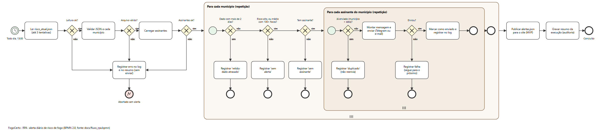
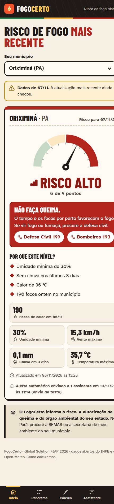

# FogoCerto · Robotic Process Automation

**Global Solution FIAP 2026.2 · CitizenTech · Engenharia de Software 4º ano** · Atividade "Do Processo Manual à Automação Inteligente"

| Nome completo | RM |
|---|---|
| Breno Silva | RM99275 |
| Eduardo Araujo | RM99758 |
| Gabriela Trevisan | RM99500 |
| Gustavo Akio | RM550241 |
| Rafael Franck | RM550875 |

- Vídeo (até 3 min): _a definir_
- Repositório: <https://github.com/BrenoDevSilva/FogoCerto> (pasta `rpa/`)

## O problema e o papel da automação

O FogoCerto calcula todo dia o risco de fogo de 15 municípios do Pará (dados abertos do INPE e do Open-Meteo, pasta `bigdata/`) e mostra no site. Mas o site só avisa quem **abre o site**. Sem automação, alguém da defesa civil teria que abrir o arquivo todo dia, ver quais municípios estão em risco alto, procurar quem mora lá e mandar mensagem um por um. É um trabalho repetitivo, fácil de esquecer e que acontece justamente nos dias mais secos.

O robô faz isso sozinho, uma vez por dia: **lê o risco → decide por município → repete para cada assinante → envia por Telegram ou e-mail → registra tudo → publica para o site o que foi avisado.** O produtor ou o brigadista recebe o aviso no celular sem precisar abrir nada.

O alerta **nunca autoriza queima**. Ele informa o risco e encaminha ao órgão ambiental.

## Arquitetura

```
 Big Data (Databricks) ──> site/public/data/risco_atual.json ──┬──> site (cartão de risco)
                                   (mesmo arquivo)              │
                                                                v
            config/assinantes.json ──>  RPA (src/executar.py, todo dia às 13:00)
            (local, fora do Git)          │  ler + validar (3 tentativas)
                                          │  para cada município: decidir
                                          │     para cada assinante: deduplicar -> enviar
                                          ├──> Telegram / e-mail
                                          ├──> logs/execucao/ (log + resumo JSON por execução)
                                          └──> site/public/data/alertas.json ──> site mostra
                                               "Alerta automático enviado a N assinantes em ..."
```

Fluxo em BPMN 2.0: [`docs/fluxo_rpa.bpmn`](docs/fluxo_rpa.bpmn) (abre no Camunda Modeler ou em demo.bpmn.io) e a figura [`docs/fluxo_rpa.png`](docs/fluxo_rpa.png).



| Arquivo | Papel |
|---|---|
| [`src/executar.py`](src/executar.py) | Orquestra o fluxo, os logs, o resumo e a saída para o site |
| [`src/fonte.py`](src/fonte.py) | Lê o `risco_atual.json` (arquivo ou URL) com novas tentativas e valida cada item |
| [`src/regras.py`](src/regras.py) | Regras de negócio (decisão) e texto do alerta |
| [`src/envio.py`](src/envio.py) | Assinantes e canais: Telegram, e-mail (SMTP) e simulado |
| [`src/estado.py`](src/estado.py) | Evita reenvio (duplicados) e publica o `alertas.json` para o site |
| [`src/telegram_chat_id.py`](src/telegram_chat_id.py) | Ajuda a descobrir o `chat_id` de um assinante de teste |
| [`tests/`](tests/) | 34 testes automáticos e 7 cenários com evidências |

**Tecnologia: Python 3.11+ só com a biblioteca padrão.** Motivos: versiona no GitHub e é testável com `pytest` (o enunciado aceita Python); não precisa de servidor nem de licença (UiPath e Power Automate exigem conta e máquina Windows); roda em qualquer agendador (Agendador de Tarefas do Windows, cron ou GitHub Actions); sem dependência externa, não há pacote para quebrar ou para auditar.

## Regras de negócio

**Repetição:** um laço passa por **cada município** do arquivo e, dentro dele, outro passa por **cada assinante** daquele município.

**Decisão por município** ([`src/regras.py`](src/regras.py)):

| Situação | Decisão | Por quê |
|---|---|---|
| `data` mais de 2 dias antes de hoje | **retido**, sem alerta | dado velho não pode virar aviso "atual" (o normal é `data` = ontem, porque a coleta traz o dia anterior) |
| `nivel_risco = alto` | **alerta**: "Não faça queima" | é o nível em que o próprio site recomenda não queimar |
| `nivel_risco = medio` e `focos_ontem ≥ 100` | **alerta de atenção**: "Evite queimar" | 100 focos é o ponto em que a regra de risco do Big Data dá a nota máxima de focos: há muito fogo em volta mesmo com o tempo não crítico |
| demais casos | sem alerta | evita "alerta demais", que faz as pessoas pararem de ler |

Os limites mudam por variável (`LIMIAR_FOCOS`, `MAX_ATRASO_DIAS`) sem mexer no código.

**Por assinante:** se a chave `município + data do dado + assinante` já foi enviada, **não reenvia** (o arquivo pode não mudar de um dia para o outro). Se o envio falha, registra e **segue para o próximo**; na execução seguinte, só o que falhou é tentado de novo.

**Mensagem** (sempre com a data do dado, nunca "hoje há risco"):

```
FogoCerto · risco ALTO em Oriximiná (PA)
Risco ALTO com dados fechados de 07/11. Motivos: umidade minima de 30%; sem chuva nos ultimos 3 dias; calor de 36 C; 190 focos ontem no municipio.
Não faça queima. Se vir fogo ou fumaça, ligue para a Defesa Civil (199) ou os Bombeiros (193).
O FogoCerto informa o risco. A autorização de queima é do órgão ambiental do seu estado.
```

## Exceções e resiliência (sem falha silenciosa)

| Falha | O que o robô faz | Código de saída |
|---|---|---|
| Arquivo ausente, site ou API fora do ar, timeout | 3 tentativas com espera crescente (2 s, 4 s); se não der, **aborta sem enviar** e registra | 2 |
| HTTP 4xx (endereço errado) | não insiste e aborta | 2 |
| JSON quebrado, vazio ou que não é lista | aborta sem enviar | 2 |
| Item com nível desconhecido, data futura, sem código, focos negativos | ignora **só o item**, registra o motivo e segue | 0 |
| Município repetido no arquivo | mantém o primeiro e registra | 0 |
| Arquivo de assinantes ausente ou ilegível | aborta sem enviar | 2 |
| Assinante com canal ou destino inválido | ignora o assinante e registra | 0 |
| Alerta já enviado (mesmo município, mesma data) | não reenvia, registra "duplicado" | 0 |
| Falha de envio (Telegram fora, chat bloqueado, SMTP) | 3 tentativas no Telegram; registra e segue | 1 |
| Canal sem configuração (ex.: sem SMTP) | falha só os assinantes daquele canal | 1 |

O estado é gravado a cada envio, de forma atômica: se o robô cair no meio, não reenvia o que já saiu.

## Logs e auditoria

- `logs/execucao/rpa_AAAA-MM-DD.log`: uma linha por evento, com data e hora, município, nível, decisão, assinante (`ref`) e resultado.
- `logs/execucao/execucoes/<id>.json`: resumo de cada execução (início, fim, status, fonte, data do dado, contagens, problemas e erros).
- Amostras reais em [`logs/amostras/`](logs/amostras/).

```
2026-11-13 11:14:18 | INFO    | municipio=Almeirim id=1500503 nivel=alto focos=366 data=2026-11-07 decisao=risco_alto assinante=400d35bde9 canal=telegram resultado=enviado
2026-11-13 11:14:18 | INFO    | municipio=Castanhal id=1502400 nivel=baixo focos=11 data=2026-11-07 decisao=sem_alerta_risco_baixo
2026-11-13 11:14:18 | INFO    | fim status=concluido contagens={"municipios_lidos": 15, "itens_invalidos": 0, "municipios_com_alerta": 8, "enviados": 5, "sem_assinante": 4, "sem_alerta": 7}
```

O assinante aparece só como `ref`, um resumo SHA-256 de 10 caracteres: dá para auditar sem expor o contato.

## Integração com o MVP

- **Entrada:** o robô lê o **mesmo** `site/public/data/risco_atual.json` que o site mostra. Com o site publicado, basta trocar `RISCO_FONTE` para `<URL do site>/data/risco_atual.json` e, quando existir, para a API `GET /risco`.
- **Saída:** o robô publica `site/public/data/alertas.json` (sem nenhum contato pessoal). O site lê esse arquivo ([`site/src/data/alertas.ts`](../site/src/data/alertas.ts)) e mostra no cartão do município: **"Alerta automático enviado a N assinantes em DD/MM/AAAA às HH:MM"**. Se o arquivo faltar, o site segue normal.



## Como reproduzir

Pré-requisito: Python 3.11 ou mais novo. Tudo dentro de `rpa/`.

```bash
# 1. Assinantes de teste (o arquivo real fica fora do Git)
cp config/assinantes.example.json config/assinantes.json

# 2. Rodar sem enviar nada (grava as mensagens em logs/execucao/caixa_simulada.txt)
python src/executar.py --simular --data-referencia 2026-11-08
```

`--data-referencia` faz o robô agir como se fosse aquele dia, útil quando o arquivo oficial ainda não foi atualizado. Sem ela, vale a data de hoje em Brasília.

### Envio real pelo Telegram

1. No Telegram, fale com o **@BotFather**, crie um bot (`/newbot`) e copie o token.
2. `cp .env.example .env` e preencha `TELEGRAM_BOT_TOKEN`. O `.env` não vai para o Git.
3. Do celular de teste, abra o bot e mande `/start`. Rode `python src/telegram_chat_id.py` para ver o `chat_id`.
4. Coloque o `chat_id` em `config/assinantes.json` no município desejado (`"canal": "telegram"`).
5. `python src/executar.py`

E-mail: preencha `SMTP_*` no `.env` (no Gmail, use uma "senha de app") e use `"canal": "email"`.

### Agendar (mínimo de intervenção humana)

Rodar **depois** da coleta do Big Data (10:30), por exemplo às 13:00.

Windows (Agendador de Tarefas):
```powershell
schtasks /Create /SC DAILY /ST 13:00 /TN "FogoCerto RPA" /TR "python C:\caminho\FogoCerto\rpa\src\executar.py"
```
Linux ou Mac (cron): `0 13 * * * cd /caminho/FogoCerto/rpa && python3 src/executar.py`

## Testes e validação

```bash
python -m pytest -q tests          # 34 testes automáticos
python tests/gerar_evidencias.py   # 7 cenários com evidências em tests/evidencias/
```

| Cenário ([`tests/evidencias/`](tests/evidencias/)) | Tipo | Resultado esperado e obtido |
|---|---|---|
| `01_sucesso_risco_alto` | sucesso | 2 municípios com alerta, 3 mensagens enviadas, `alertas.json` publicado |
| `02_decisao_sem_alerta` | decisão | risco baixo e médio sem focos: nenhuma mensagem |
| `03_falha_fonte_ausente` | falha | 3 tentativas, abortado, nenhuma mensagem, saída 2 |
| `04_falha_json_invalido` | falha | abortado, nenhuma mensagem, saída 2 |
| `05_dados_inconsistentes` | falha parcial | 5 itens ruins ignorados com motivo; o válido recebe alerta |
| `06_falha_de_envio` | falha parcial | 1 envio falha, os outros 2 saem, saída 1 |
| `07_duplicado_nao_reenvia` | resiliência | 2ª execução no mesmo dia: 0 enviados, 3 duplicados |

Os testes automáticos cobrem também: API instável que volta na 3ª tentativa (servidor HTTP local), 404 sem insistir, dado atrasado retido, data futura, canal sem configuração, reenvio só do que falhou e uma checagem de LGPD (nenhum contato aparece em log, estado, resumo ou `alertas.json`).

## Segurança e LGPD

- **Dado pessoal** é só o contato (`chat_id` ou e-mail). Ele fica apenas em `config/assinantes.json`, na máquina que roda o robô, e **não vai para o Git** (`.gitignore`). Nos testes e no exemplo, os contatos são fictícios.
- **Logs, estado, resumo e `alertas.json`** usam só o `ref` (SHA-256 truncado). Um teste automático garante que nenhum contato vaze.
- **Segredos** (token do bot, senha SMTP) ficam no `.env` ou em variáveis de ambiente, nunca no código. O token é mascarado se aparecer numa mensagem de erro.
- **Consentimento:** só recebe quem pediu. Na demonstração, só contas de teste do grupo.
- **Minimização:** a mensagem leva município, nível, motivos e data; nada sobre a pessoa.
- No Big Data, a tabela `assinantes_alerta` guarda só o hash do e-mail, a mesma lógica aplicada aqui.

## Limitações e próximos passos

- O arquivo oficial é atualizado por pull request do time de Big Data. Se atrasar mais de 2 dias, o robô retém os alertas (de propósito).
- O alerta é por município, não por distância do foco até a propriedade: o dado atual não traz a localização do assinante.
- Próximo passo: rodar no GitHub Actions agendado, com os segredos em GitHub Secrets e o estado guardado entre execuções.
